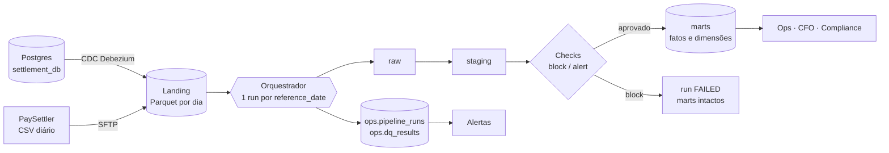
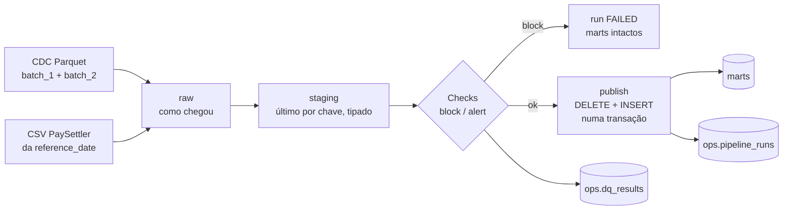

# Case Técnico — Engenheiro(a) de Dados Sênior / Especialista

## Contexto de Negócio

Você está entrando no time de dados de uma fintech que processa liquidações de pagamentos para merchants. A empresa opera o **Settlement Reconciliation Service** — um serviço em produção que:

1. Recebe diariamente um **arquivo CSV** do processador de pagamentos externo (**PaySettler**) com as transações liquidadas nas últimas 24h
2. Compara essas transações com os **registros internos** do sistema
3. Categoriza cada transação e persiste os resultados em um **PostgreSQL** (`settlement_db`)

O serviço funciona bem, mas **todos os dados vivem apenas no banco transacional**. O time de operações precisa saber se a taxa de discrepância está subindo. O CFO quer o volume transacionado por dia. Compliance precisa de histórico de auditoria. **Ninguém tem acesso estruturado a nada disso hoje.**

### Sua Missão

Construir uma solução que transforme esses dados em **produtos de dados** consumíveis pelo negócio. Cabe a você decidir como.

---

## Domínio: Reconciliação de Liquidações

> O glossário completo está em [`docs/domain-glossary.md`](docs/domain-glossary.md). Leia antes de começar.

### Tabelas Fonte (`settlement_db`)

**`transactions`** — Transações internas do sistema

| Coluna | Tipo | Descrição |
|--------|------|-----------|
| `id` | bigint | PK |
| `transaction_id` | uuid | Identificador único da transação |
| `merchant_id` | varchar | Identificador do merchant |
| `amount` | decimal | Valor da transação (BRL) |
| `currency` | varchar | Moeda (ISO 4217) |
| `status` | varchar | `COMPLETED`, `PENDING`, `FAILED` |
| `description` | varchar | Descrição da transação |
| `created_at` | timestamp | Data de criação |
| `updated_at` | timestamp | Última atualização |

**`reconciliation_runs`** — Execuções de reconciliação

| Coluna | Tipo | Descrição |
|--------|------|-----------|
| `id` | bigint | PK |
| `reference_date` | date | Data de referência do arquivo (dia de negócio) |
| `file_name` | varchar | Nome do arquivo processado |
| `status` | varchar | `IN_PROGRESS`, `COMPLETED`, `FAILED` |
| `total_transactions` | integer | Total de transações no arquivo |
| `started_at` | timestamp | Início do processamento |
| `completed_at` | timestamp | Fim do processamento |
| `created_at` | timestamp | Data de criação do registro |

**`reconciliation_results`** — Resultados da reconciliação

| Coluna | Tipo | Descrição |
|--------|------|-----------|
| `id` | bigint | PK |
| `run_id` | bigint | FK → `reconciliation_runs.id` |
| `transaction_id` | uuid | Identificador da transação |
| `merchant_id` | varchar | Identificador do merchant |
| `category` | varchar | `MATCHED`, `MISMATCHED`, `UNRECONCILED_PROCESSOR`, `UNRECONCILED_INTERNAL` |
| `internal_amount` | decimal | Valor no sistema interno (null se unreconciled_processor) |
| `processor_amount` | decimal | Valor no PaySettler (null se unreconciled_internal) |
| `difference` | decimal | Diferença absoluta entre valores |
| `created_at` | timestamp | Data de criação |

**`enterprise_company`** — Dados cadastrais dos merchants

| Coluna | Tipo | Descrição |
|--------|------|-----------|
| `id` | bigint | PK |
| `merchant_id` | varchar | Código do merchant |
| `legal_name` | varchar | Razão social |
| `trade_name` | varchar | Nome fantasia |
| `document` | varchar | CNPJ |
| `primary_cnae` | varchar | CNAE principal |
| `created_at` | timestamp | Data de criação |
| `updated_at` | timestamp | Última atualização |

### Arquivo CSV do PaySettler

O processador externo envia diariamente um CSV com as transações liquidadas.

| Coluna | Tipo | Descrição |
|--------|------|-----------|
| `transaction_id` | uuid | Identificador da transação |
| `merchant_id` | varchar | Identificador do merchant |
| `amount` | decimal | Valor liquidado |
| `currency` | varchar | Moeda (ISO 4217) |
| `settled_at` | datetime (ISO 8601, UTC) | Data/hora da liquidação |
| `processor_reference` | varchar | Referência interna do processador |
| `status` | varchar | `SETTLED` ou `REVERSED` |

---

## Stack

- **Linguagem:** Python 3.12+
- **Processamento:** DuckDB
- **Conteinerização:** Docker + Docker Compose
- **Armazenamento:** Filesystem local

A solução deve **rodar localmente** com `docker-compose up`.

---

## Dados de Exemplo

Na pasta `docs/sample-data/` você encontrará:

- `transactions_batch_1.parquet` — Transações internas (lote 1)
- `transactions_batch_2.parquet` — Transações internas (lote 2)
- `reconciliation_runs.parquet` — Execuções de reconciliação
- `reconciliation_results.parquet` — Resultados categorizados
- `settlement_paysettler.csv` — Arquivo CSV do PaySettler
- `enterprise_company.parquet` — Dados cadastrais de merchants

---

## Como Começar

1. **Faça um fork** deste repositório para sua conta pessoal do GitHub
2. Clone o seu fork e trabalhe nele normalmente
3. Suba o ambiente:

```bash
docker compose up -d --build
# ou: make up
```

Um `Makefile` no repositório expõe atalhos para as operações mais comuns (`make help` lista os alvos disponíveis). O uso é opcional.

---

## Requisitos

### Parte 1 — Modelagem e Analytics

Usando os dados disponíveis, **modele e implemente tabelas analíticas** que atendam os seguintes consumidores:

- **Operações:** precisa acompanhar a saúde das reconciliações no dia a dia
- **CFO:** precisa de visão consolidada do volume financeiro
- **Compliance:** precisa de rastreabilidade e histórico para auditorias

**A forma e o conteúdo das tabelas são decisão sua.** Traduza as dores acima em métricas e tabelas analíticas (fatos e dimensões) que você defenderia em produção. Documente, para cada consumidor:

- **Quais perguntas** seu modelo consegue responder (e quais deliberadamente não)
- **Por que** essas e não outras (priorização, tradeoffs de escopo vs tempo)

Entregue também exemplos de queries rodando contra suas tabelas que respondem as perguntas que você propôs. Queremos ver seu raciocínio de produto, não só SQL.

---

### Parte 2 — Pipeline de Dados

Implemente o pipeline que processa as fontes de dados disponíveis e prepara o insumo para as tabelas analíticas da Parte 1.

O volume em `docs/sample-data/` é pequeno de propósito — assuma **~5M transações/mês em produção** e projete para crescer. Se quiser validar na prática como seu pipeline se comporta em escala, use o gerador descrito na seção _"Dados de Exemplo e Geração de Volume"_.

Critérios de qualidade (como você os atende é decisão sua — documente suas escolhas):

- **Correção:** a saída do pipeline bate com o contrato de dados que você propôs
- **Idempotência:** executar o pipeline para a mesma data de referência duas vezes não pode duplicar registros nem corromper as tabelas. Considere como isso se manifesta na sua CLI, nas tabelas finais e em falhas no meio da execução
- **Observabilidade:** em produção, quando algo quebrar, que sinais você precisaria para diagnosticar rapidamente?
- **Qualidade de dados:** quais checks você adicionaria para proteger os consumidores de downstream de dados incorretos? O que faria o pipeline parar versus apenas alertar?
- **Testabilidade:** como você valida automaticamente que uma mudança no código não quebra o comportamento?

Stack obrigatória: **DuckDB** para processamento, **Python 3.12+**, **Docker Compose** para subir o ambiente.

---

### Parte 3 — Arquitetura

#### 3.1 Desenho de Arquitetura

**Explique e/ou desenhe** como você levaria esses dados do banco transacional até o consumo pelo negócio em produção.

**Resposta**



Em produção, o fluxo é este:

1. **Captura.** O Debezium lê o WAL do Postgres e grava extracts CDC (`Op`, `_timestamp`) em Parquet particionado por dia no object storage. Não consultamos o banco transacional, então não há carga nele. O CSV do PaySettler chega por SFTP e é copiado para a mesma landing.
2. **Processamento.** Um orquestrador (Airflow ou Dagster) dispara um run por `reference_date` e por processor, executando o mesmo `recon run` deste repositório. O run passa por raw, staging, checks e publicação dos marts.
3. **Publicação.** Os marts são trocados numa única transação por `reference_date`. Se um check `block` falhar, o run fica `FAILED` e os marts continuam como estavam: o consumidor vê dado atrasado, nunca dado errado.
4. **Consumo.** Operações, CFO e Compliance leem só os marts (BI ou as queries de `queries/`). `ops.*` alimenta os alertas.

| Local (este repo) | Produção |
|---|---|
| `docs/sample-data/` e `/tmp/generated` | Landing Parquet no object storage |
| `docker compose exec ... recon run` | Tarefa do orquestrador, com retry e SLA |
| `data/warehouse.duckdb` | Marts em Parquet/tabelas particionadas por data, consultáveis pelo BI |
| `ops.dq_results` e logs JSON | Mesmas tabelas, mais envio para Slack/PagerDuty |

#### 3.2 Troubleshooting

Segunda-feira de manhã. Ops abre um chamado: os dashboards de reconciliação estão sem dados desde sexta-feira à noite. Você é o primeiro a chegar.

Como você investigaria? Que artefatos do próprio pipeline você consultaria? Até onde iria antes de acionar mais alguém?

**Resposta**

> Segunda-feira de manhã. Ops abre um chamado: os dashboards de reconciliação estão sem dados desde sexta-feira à noite.

Primeiro separo o problema em três casos. Nos três, o pipeline já grava o que preciso para decidir em minutos.

**1. O pipeline rodou? (`ops.pipeline_runs`)**

```sql
SELECT reference_date, status, started_at, duration_ms, settlement_file, git_sha, error
FROM ops.pipeline_runs
WHERE reference_date >= current_date - 5
ORDER BY started_at DESC;
```

- **Nenhum run desde sexta.** O problema está antes do pipeline: scheduler, container ou job parado. Olho o orquestrador e não o dado.
- **Runs `FAILED`.** A coluna `error` já diz o motivo. Se `git_sha` mudou na sexta, suspeito de deploy.
- **Runs `SUCCESS`.** O pipeline está saudável e o problema pode estar no consumo ou em dado vazio. Vou para o passo 3.

**2. Por que bloqueou? (`ops.dq_results`)**

```sql
SELECT reference_date, check_name, layer, severity, observed_value, threshold, sample_keys
FROM ops.dq_results
WHERE run_id IN (SELECT run_id FROM ops.pipeline_runs WHERE status = 'FAILED')
  AND NOT passed
ORDER BY checked_at DESC;
```

- `settlement_file_missing`: o PaySettler não entregou o CSV do dia. É a causa mais provável de sexta à noite em diante. O erro traz o nome e a pasta procurados.
- `raw_cdc_load_failed`: o extract CDC está ausente ou ilegível. A captura parou.
- `raw_settlement_read_failed`: o CSV chegou corrompido.
- Um check `block` de conteúdo (UUID inválido, `amount` ≤ 0, moeda fora do domínio) indica dado ruim na origem, e `sample_keys` mostra as chaves.

**3. Os marts estão desatualizados ou vazios?**

```sql
SELECT processor, max(reference_date) AS ultima_data, count(*) AS linhas
FROM marts.fct_reconciliation_daily GROUP BY processor;
```

Como `FAILED` deixa os marts intactos, a tabela deve mostrar a última sexta com sucesso. Se mostrar vazio ou outra data, o problema é de consumo (view, filtro de data do dashboard, permissão) e não do pipeline.

**4. Logs.** Cada linha de log é JSON e traz `run_id` e `reference_date`. Filtro pelo `run_id` do passo 1 e vejo em que etapa o run parou (`staging built`, `marts published`, `run failed`). Localmente os logs saem na saída de erro (stderr) do comando `recon`; em produção, nos logs da tarefa do orquestrador.

**5. Recuperação.** Quando a causa é externa e resolvida (o CSV chegou, o CDC voltou), reprocesso o intervalo:

```bash
docker compose exec pipeline python -m recon backfill --start 2025-03-14 --end 2025-03-16 --source-dir <pasta-com-paysettler/>
```

É seguro repetir: cada data é atômica e o DELETE+INSERT é por `reference_date`, então rodar de novo não duplica nada. Cada tentativa fica registrada como um novo run em `ops.pipeline_runs`. Datas sem CSV continuam `FAILED` e o backfill sai com código 1, listando quais.

**Até onde vou sozinho.** Faço o diagnóstico, o reprocesso e a comunicação com Ops. Aciono outra pessoa quando a causa está fora do meu alcance: o PaySettler não enviou o arquivo (contato do processador), a captura CDC do Postgres parou (time de plataforma/DBA), o disco ou o `warehouse.duckdb` está corrompido (infra), ou o backfill falha de novo com o mesmo erro depois de a origem ser corrigida (nesse caso é bug e abro incidente). Registro no chamado a causa, as datas afetadas e o `run_id` do reprocesso.

#### 3.3 Escalabilidade

Hoje o volume é pequeno, mas o negócio projeta chegar em **~5M transações/dia** em 18 meses (≈1,8B/ano em `reconciliation_results`). Como você prepararia a plataforma para esse crescimento? Onde o desenho atual quebra primeiro?

**Resposta**

**A conta.**

| Item | Conta | Resultado |
|---|---|---|
| Volume hoje (enunciado da Parte 2) | 5M/mês ÷ 30 | ≈ 167 mil/dia |
| Crescimento projetado | 5M ÷ 167 mil | ≈ 30× |
| Ano com 5M/dia | 5M × 365 | ≈ 1,8B linhas/ano em `reconciliation_results` |
| Acumulado em 18 meses | 5M × 548 | ≈ 2,7B linhas |
| Linhas de CDC relidas por run hoje | todo o histórico | 2,7B no mês 18 (hoje ≈ 9,5 mil na amostra de 10k) |
| `audit_reconciliation_history` | linhas do fato do dia × runs por data | ≈ 5M linhas por run; 1,8B/ano com 1 run por data, e cresce com cada reprocesso |

**Medido** (gerador com 10 mil linhas, 30 dias, backfill de 45 datas): ≈ 0,9 s por `reference_date`. Nesse dataset cada run relê ≈ 9,5 mil linhas de transações; nas 82 runs bem-sucedidas foram ≈ 780 mil linhas relidas para ≈ 9,5 mil linhas de CSV. **Não medi** nada acima de 10 mil linhas por run: tudo abaixo é projeção, não resultado.

**Onde quebra primeiro, em ordem:**

1. **Releitura total do CDC a cada run.** `raw` e `staging` são recriados a cada execução, então o custo por run cresce com o histórico e não com o dia. Com 2,7B linhas acumuladas isso deixa de caber no SLA muito antes de o join ficar lento. É o primeiro ponto a atacar.
2. **Join do lado interno sem filtro de data.** `fct_reconciliation` varre todas as transações internas não deletadas. Precisa olhar só o que importa para D.
3. **Auditoria que copia o fato inteiro a cada run.** Com ≈ 5M linhas por run, a tabela passa de 1,8B linhas/ano e cada reprocesso soma outras 5M.
4. **Um único escritor.** O DuckDB aceita um processo escrevendo no arquivo. Backfill e reprocessos de datas diferentes são sequenciais, e não dá para paralelizar por data no mesmo arquivo.

**Como eu prepararia:**

- **Raw/staging incrementais e particionados por data.** Ingerir só o delta do CDC de D e manter o estado atual por `transaction_id` em partições. Junto, controle de arquivos já ingeridos (hash), porque o raw passaria a ser acumulado.
- **Restringir o lado interno do join** aos `transaction_id` do CSV de D mais as internas da janela `[D-7, D]`, em vez de todas as transações.
- **Auditoria particionada por mês com retenção.** Partições antigas arquivadas em Parquet, e consultas as-of limitadas à partição relevante.
- **Marts e histórico em Parquet particionado** (por `reference_date`), com um warehouse analítico na frente para leitura concorrente, e DuckDB como motor de processamento por partição. Isso também resolve o escritor único: uma partição por run.
- **Paralelizar por processor e por data** nas tarefas do orquestrador, cada uma escrevendo em sua partição.
- **Alerta de anomalia de volume** (comparar com a média móvel de 7 dias): com 30× mais dados, um CSV pela metade passa a ser um problema silencioso.

---

## Dados de Exemplo e Geração de Volume

O repositório oferece duas fontes de dado. **A escolha de volume e de quais fontes usar é sua.**

### 1. Fixture pequeno — `docs/sample-data/`

Cerca de 1.000 transações internas e ~500 liquidações. Pensado para exploração, desenvolvimento local e como insumo default dos exemplos de queries da Parte 1.

### 2. Gerador sintético — `scripts/generate_sample_data.py`

Produz o mesmo schema do fixture (CDC `Op`/`_timestamp`, schema drift entre batches, padrões realistas de dados sujos) em volume arbitrário. Útil para validar seu pipeline em escala — por exemplo, ao redor dos ~5M transações/mês assumidos na Parte 2.

**Você define o volume e as características.** O script é parametrizável:

```bash
# dataset médio para smoke em escala (1M transações, 90 dias)
python scripts/generate_sample_data.py --rows 1000000 --days 90 --out /tmp/medium

# dataset alinhado à projeção de ~5M transações/mês
python scripts/generate_sample_data.py --rows 5000000 --days 30 --out /tmp/month
```

Flags principais:

| Flag | Descrição | Default |
|------|-----------|---------|
| `--rows N` | Total de transações internas a gerar | `1000000` |
| `--days N` | Janela temporal em dias | `90` |
| `--merchants N` | Número de merchants | `500` |
| `--seed N` | Semente determinística | `42` |
| `--out PATH` | Diretório de saída | `docs/sample-data` |

Rode `python scripts/generate_sample_data.py --help` para a lista completa. Dentro do container, `make generate` (10k linhas) e `make generate-large` (1M linhas) são atalhos prontos.

---

## Uso de IA

Fique à vontade para usar ferramentas de IA durante o desafio. Se usar, documente no item _"Ferramentas de IA utilizadas"_ da entrega quais ferramentas e para quê. Se mantiver prompts, configs (`CLAUDE.md`, `.cursorrules`, etc.) ou transcrições no repositório, melhor — ajuda a entender seu processo.

---

## Entrega

1. Ao finalizar, **abra um Pull Request do seu fork para o repositório original** (branch `main`)
2. Preencha as seções abaixo no README do seu PR:

### Como rodar

_Descreva os passos para rodar a aplicação._

Requisito: Docker com Compose. O `make` é opcional; ao lado de cada alvo está o comando equivalente. Os comandos `docker compose exec` rodam dentro do container `pipeline`, que fica ativo com `tail -f /dev/null`.

**1. Subir o ambiente**

```bash
make up                     # ou: docker compose up -d --build
```

**2. Rodar os testes e o lint**

```bash
make test                   # ou: docker compose exec pipeline pytest tests/ -v
docker compose exec pipeline ruff check .
```

**3. Rodar o pipeline na amostra** (`docs/sample-data/`). A data de referência vem de você; ela não é inferida do arquivo.

```bash
docker compose exec pipeline python -m recon run --reference-date 2025-03-16 --settlement-file docs/sample-data/settlement_paysettler.csv
```

Rode duas vezes: as contagens de `marts.*` não mudam (idempotência), exceto `audit_reconciliation_history`, que só acrescenta um snapshot por run. O banco fica em `data/warehouse.duckdb`.

**4. Rodar em volume com o gerador** (10 mil transações, 30 dias)

```bash
make generate               # ou: docker compose exec pipeline python scripts/generate_sample_data.py --rows 10000 --days 30 --merchants 100 --seed 42 --out /tmp/generated
docker compose exec pipeline python -m recon backfill --start 2025-03-01 --end 2025-03-31 --source-dir /tmp/generated
```

O gerador cria CSVs de 2025-03-01 a 2025-04-14 e não escreve arquivo para dias sem linhas (a janela de março fecha sem falhas). No Git Bash do Windows, prefixe os comandos com `MSYS_NO_PATHCONV=1`, senão `/tmp/generated` é reescrito para um caminho do Windows. Datas sem arquivo ficam `FAILED` com `settlement_file_missing`, e o backfill sai com código 1 listando quais.

**5. Consultar os resultados.** Cada consulta de `queries/*.sql` começa com `-- name: <id>`. Para rodar uma:

```bash
docker compose exec pipeline python -c "import duckdb; t=open('queries/ops.sql').read().split('-- name: ops_daily_health')[1].split('-- name:')[0]; print(duckdb.connect('data/warehouse.duckdb', read_only=True).sql(t.strip().rstrip(';')))"
```

Troque `ops.sql` e `ops_daily_health` por outro arquivo e nome. Alguns parâmetros (data, `transaction_id`) ficam num CTE `params` no começo da consulta.

**6. Encerrar**

```bash
make down                   # ou: docker compose down
```

Sem migrations: depois de mudar o schema, apague `data/warehouse.duckdb` e reprocesse.

### Premissas e decisões

_Documente as ambiguidades que encontrou e as decisões que tomou._

**Ambiguidades e decisões**

1. **Quem define a categoria.** A categoria oficial é a recalculada pelo pipeline a partir do glossário. A do serviço (`reconciliation_results`) é guardada como `source_category` para comparação. Na amostra, 132 linhas MATCHED têm |dif| > 0,01 e 5 têm `difference` diferente de |interno − processador|, então confiar no serviço seria propagar erro.
2. **Estado atual do CDC.** Vale o último registro por `transaction_id`, ordenado por `_timestamp` e depois `id`. Empate total é resolvido pela ordem do ciclo de vida D > U > I. Op `D` tira a transação do matching.
3. **Janela de 7 dias.** `created_at::date ∈ [D-7, D]` (UTC) define o escopo de `UNRECONCILED_INTERNAL`, não o matching. O matching é por `transaction_id` contra todas as internas não deletadas. Uma liquidação tardia cuja interna está fora da janela é comparada por valor, com `in_window = false` e `is_late_settlement = true`, como faz o serviço.
4. **Tolerância.** |diferença| ≤ R$ 0,01 é `MATCHED`. Dinheiro é `DECIMAL(18,2)` a partir do staging, e nunca se compara `float`.
5. **`amount` e `REVERSED`.** Nos dados, `amount` é sempre positivo (as 27 linhas REVERSED também). O sinal vem do status (`signed_amount`). `amount` ≤ 0 em qualquer status bloqueia o run.
6. **CSV sujo.** Os valores vêm em formato BR (`R$ 32.245,91`) e `settled_at` em três formatos (sem fuso é tratado como UTC). Há 10 linhas duplicadas idênticas na amostra e `merchant_id` em minúsculas. Tudo é normalizado e vira alerta. Valor com mais de 2 casas (ex.: `1.234`) é ambíguo entre milhar e decimal, então bloqueia.
7. **Mesmo `transaction_id` com versões diferentes no CSV.** Vale a última por `settled_at`, com `has_reversal` e `version_count`. Em empate de `settled_at`, ganha `REVERSED`, depois o maior `processor_reference`.
8. **Moeda.** Sem câmbio. Os valores ficam na moeda original e as consultas nunca somam moedas diferentes.
9. **A amostra não reconcilia.** Na amostra, 0 de 510 valores do CSV batem com o interno, e só 127 transações estão na janela. Por isso a correção é validada com o gerador, que tem dados coerentes: **100% de concordância** (10.000 de 10.000 transações) com o gabarito, com dados sujos e com `--clean`. A amostra serve para provar a limpeza.
10. **Data de referência da amostra.** Vem do usuário (`--reference-date` + `--settlement-file`), nunca do conteúdo do arquivo.

**Block vs. alert.** Bloqueia o que tornaria o mart incorreto: arquivo ausente ou vazio, colunas obrigatórias ausentes, `transaction_id` inválido, valor não convertível ou ≤ 0, domínio de moeda/status, `settled_at` ilegível, chave duplicada no fato, conservação de contagens (liquidações e internas) e perda de precisão. Só alerta o que é dado sujo já tratado ou sinal de negócio: duplicados idênticos, formato BR, REVERSED órfão, liquidação tardia, liquidação de transação `FAILED`, replay de CDC, taxa de `MISMATCHED` > 5% e divergência com o serviço. A lista completa está em `src/recon/quality/registry.py`.

**Idempotência (stage → check → publish).** Raw e staging são recriados a cada execução (`CREATE OR REPLACE`). Os fatos são montados primeiro em tabelas temporárias e os checks rodam sobre elas. Só então uma única transação faz `DELETE` por `reference_date` e `processor` e `INSERT` a partir do stage. Se um check bloquear ou houver exceção, nada é escrito: run `FAILED` ⇒ marts intactos.

**Resultados medidos** (gerador, 10 mil linhas, 30 dias, seed 42):

| Medida | Resultado |
|---|---|
| Concordância com o gabarito | 100% (10.000 de 10.000) |
| Mistura de categorias (dados sujos) | MATCHED 85,4% · MISMATCHED 4,8% · UNRECONCILED_PROCESSOR 5,0% · UNRECONCILED_INTERNAL 4,9% (gerador: 85/5/5/5) |
| Backfill duas vezes | Todos os marts idênticos (contagem e hash); só a auditoria cresce |
| Desempenho | ≈ 0,9 s por `reference_date` (45 datas em 38,8 s) |
| Blocks | Só `settlement_file_missing` em 4 datas sem CSV (2025-04-02, 04-05, 04-10, 04-13) |

### Visão geral da arquitetura

_Descreva a estrutura do projeto. Diagrama é bem-vindo._



```
src/recon/
  cli.py          recon run | recon backfill
  config.py       tolerância, janela, limite de MISMATCHED, processors
  pipeline.py     orquestra raw → staging → checks → stage → checks → publish
  ingest/         cdc.py (union_by_name), settlement.py (localiza o CSV de D)
  transform/      staging.py, marts.py (stage e publish_marts)
  quality/        checks.py, registry.py (lista declarativa), runner.py
  sql/            ddl/, raw/, staging/, marts/
queries/          ops.sql, cfo.sql, compliance.sql
tests/            unitários por etapa + backfill ponta a ponta com o gerador
docs/architecture.md   plano e decisões detalhadas
```

**Camadas.** `raw` (CDC e CSV como chegaram) → `staging` (estado atual, tipado, limpo) → `marts` (fatos e dimensões). Tudo num único arquivo `data/warehouse.duckdb`, com o schema `ops` para observabilidade.

**Tabelas analíticas**

| Tabela | Grão | Consumidor |
|---|---|---|
| `fct_reconciliation` | `(reference_date, processor, transaction_id)` | Ops, Compliance |
| `fct_reconciliation_daily` | `(reference_date, processor, currency)` | Ops |
| `fct_reconciliation_run` | run do serviço | Ops, Compliance |
| `fct_financial_daily` | `(reference_date, processor, settled_date, currency, merchant_id)` | CFO |
| `fct_internal_transactions` | `transaction_id` (reconstruída por inteiro) | CFO |
| `audit_reconciliation_history` | `(pipeline_run_id, reference_date, processor, transaction_id)`, só acrescentada | Compliance |
| `dim_merchant` | merchant, SCD2 | todos |
| `ops.pipeline_runs`, `ops.dq_results` | run; check por run | operação do pipeline |

O volume interno fica numa tabela própria (`fct_internal_transactions`) porque, se ficasse no fato por `reference_date`, a mesma transação seria somada uma vez por data cuja janela a contém.

**Perguntas que o modelo responde** (cada uma tem uma consulta nomeada em `queries/`):

| Consumidor | Pergunta | Consulta |
|---|---|---|
| Operações | Como foi a reconciliação nos últimos N dias e qual a taxa de MISMATCHED? | `ops_daily_health` |
| Operações | Em quais dias a taxa passou de 5%? | `ops_days_above_mismatch_threshold` |
| Operações | Quais execuções do pipeline falharam e por quê? | `ops_failed_pipeline_runs` |
| Operações | Quais alertas de qualidade estão abertos na última execução de cada data? | `ops_open_alerts_latest_run` |
| Operações | Onde a categoria recalculada diverge do serviço? | `ops_service_divergence` |
| Operações | Quais runs do serviço falharam, não têm resultados ou declaram total diferente do arquivo? | `ops_service_runs_not_matching_file` |
| CFO | Quanto foi liquidado, revertido e qual o líquido por dia e moeda? | `cfo_net_settled_by_day` |
| CFO | Qual a taxa de reversão por mês e moeda? | `cfo_monthly_reversal_rate` |
| CFO | Quais os 10 maiores merchants por volume líquido? | `cfo_top_merchants_by_net_volume` |
| CFO | Qual o volume interno por data de criação, moeda e status? | `cfo_internal_volume_by_created_date` |
| CFO | Quanto valor ficou fora de MATCHED em uma data? | `cfo_amount_at_risk_by_date` |
| CFO | O total interno COMPLETED é compatível com o líquido liquidado? | `cfo_internal_vs_settled_by_currency` |
| Compliance | Quantas linhas de auditoria cada execução gravou? | `compliance_snapshots_per_run` |
| Compliance | Como a categoria de uma transação mudou ao longo das execuções? | `compliance_transaction_history` |
| Compliance | Qual era o resultado de uma data em um instante passado (as-of)? | `compliance_as_of` |
| Compliance | Quais reprocessamentos mudaram a categoria de uma transação? | `compliance_category_changes_between_runs` |
| Compliance | Como era cada versão cadastral de um merchant (SCD2)? | `compliance_merchant_history` |
| Compliance | Quais liquidações foram revertidas ou tardias? | `compliance_reversals_and_late_settlements` |
| Compliance | Quantas vezes cada data foi processada, com que resultado e com qual versão do código? | `compliance_pipeline_runs_per_date` |

**Por que essas e não outras.** Cada consumidor tem uma dor no enunciado, e o modelo responde a ela diretamente: Operações precisa saber se a taxa de discrepância sobe (saúde diária e alertas), o CFO quer volume por dia (liquidado, revertido, líquido e interno), e Compliance precisa reconstruir o que foi dito e quando (auditoria só acrescentada e consulta as-of). Deliberadamente **não** respondemos: conversão de moedas (sem câmbio nos dados, então não há total único em BRL), calendário de dias úteis e feriados (`dim_date` ficou fora do escopo), latência intradiária (o dado é diário) e comparação de processors (existe um só). Priorizei profundidade nas três dores em vez de mais métricas.

### Extensibilidade

_Se amanhã precisarmos plugar uma **segunda fonte de liquidação** (ex.: outro processador além do PaySettler, com schema parecido mas não idêntico), **quantos arquivos/linhas mudam** no seu projeto? Descreva o caminho concreto — quais módulos tocam, qual config precisa ser estendida, quais testes rodam de novo._

Estimativa feita lendo o código, não executada. Para um processor "B" com colunas parecidas mas não idênticas: **4 a 5 arquivos de código e ≈ 40 a 70 linhas**, mais um arquivo de teste novo. Nenhum SQL de staging ou de marts muda, porque a chave de tudo já é `(processor, transaction_id)`.

1. `src/recon/config.py` (1 linha): incluir `"processor_b"` em `PROCESSORS`.
2. `src/recon/sql/raw/settlements.sql` e `src/recon/ingest/settlement.py` (≈ 20 a 40 linhas): hoje o `read_csv` lê as colunas do PaySettler pelo nome. Cada processor passa a ter um SELECT de mapeamento para as colunas canônicas (`transaction_id`, `merchant_id`, `amount`, `currency`, `settled_at`, `processor_reference`, `status`), por exemplo um arquivo `sql/raw/settlements_<processor>.sql`. A busca do arquivo já recebe o `processor` e procura em `<source-dir>/<processor>/`. Só é preciso acrescentar o padrão de nome do novo processor em `locate_settlement_file`.
3. `src/recon/cli.py` e `src/recon/pipeline.py` (≈ 5 linhas): o default `"paysettler"` está em três assinaturas (`settlement.py` ×2 e `pipeline.py`), e a CLI não tem `--processor`. Incluir a opção e passar adiante.
4. `src/recon/sql/staging/stg_settlements.sql` só muda se o novo formato exigir outra regra de parse (por exemplo outro formato de data). Os formatos de valor BR e de `settled_at` já são tratados.
5. **Pendência real, que não é só configuração:** `fct_reconciliation` atribui o `processor` do run às linhas só internas. Com um processor isso está certo; com dois, uma transação interna sem CSV seria atribuída ao processor errado. Precisa de um campo de origem ou de uma regra de roteamento que diga a qual processor cada transação interna pertence (ver "Limites do desenho").

**Testes a rodar de novo:** `test_raw_settlement.py`, `test_staging_settlement.py`, `test_fct_reconciliation.py`, `test_publish_marts.py` e `test_pipeline.py`, para garantir que o PaySettler não regrediu. O teste novo cobre o mapeamento do processor B com um CSV pequeno e uma execução ponta a ponta com os dois processors na mesma `reference_date`, conferindo que a publicação de um não apaga as linhas do outro (o DELETE já é por `(reference_date, processor)`).

### Limites do desenho

_O que a sua arquitetura **deliberadamente não suporta hoje** e que você sabe que uma versão de produção precisaria? Dê **2 a 3 exemplos concretos** (evite "melhorar logs" ou "mais testes" — seja específico)._

1. **Um único processor de verdade.** As linhas só internas de `fct_reconciliation` recebem o `processor` passado ao run. Com 2 ou mais processors, uma transação interna sem CSV seria atribuída a quem rodou, e o `UNRECONCILED_INTERNAL` de um processor poderia ser, na verdade, uma transação do outro. Precisa de um campo na origem ou de uma regra de roteamento por transação.
2. **Raw e staging recriados em todo run.** Não há processamento incremental: cada execução relê todo o CDC, mesmo que só o CSV de D tenha mudado. Medi ≈ 780 mil linhas relidas para ≈ 9,5 mil de CSV no backfill de 10 mil transações. Em ~5M/dia isso é o primeiro gargalo (ver 3.3, "Onde quebra primeiro"). A versão de produção precisa de ingestão incremental por partição de data, com controle de arquivos já lidos (hash).
3. **Leitura tolerante do CSV.** O `read_csv` do DuckDB aceita CSV malformado sem erro: aspas abertas podem fundir linhas, e um arquivo só com cabeçalho e aspas soltas vira "vazio". Nenhum check compara o número físico de linhas do arquivo com as linhas lidas em `raw.settlements`. Produção precisa desse check como `block`.

O volume, a auditoria sem retenção e o escritor único do DuckDB também são limites do desenho; estão quantificados em 3.3.

### O que faria diferente em produção

_O que simplificou? O que a versão de produção precisaria?_

**O que simplifiquei**

- DuckDB em um arquivo local, sem lock, sem concorrência e sem orquestrador: o `backfill` é um laço sequencial na CLI.
- Os extracts CDC e o CSV são lidos de uma pasta local, sem Debezium, SFTP ou object storage.
- Sem migrations: o DDL usa `CREATE TABLE IF NOT EXISTS`, então mudança de schema exige apagar o banco e reprocessar.
- Sem `dim_date` (calendário, dia útil, feriados) e sem câmbio.
- Alertas ficam em `ops.dq_results`; nada os envia a ninguém.

**O que produção precisaria**

- **Orquestrador** (Airflow ou Dagster) com um run por `reference_date` e processor, retry, SLA e dependência do arquivo do PaySettler.
- **Captura contínua** via Debezium e landing em Parquet particionado, com raw/staging incrementais.
- **Alertas** de `ops.dq_results` e `ops.pipeline_runs` para Slack/PagerDuty (run `FAILED`, ausência de run no horário, taxa de MISMATCHED), mais o alerta de anomalia de volume contra a média móvel de 7 dias.
- **Migrations versionadas** para o schema dos marts.
- **CI/CD** com `pytest` e `ruff` a cada PR, imagem versionada e `git_sha` já gravado em `ops.pipeline_runs`.
- **Segurança e LGPD:** `dim_merchant` guarda CNPJ e razão social, então precisa de controle de acesso por consumidor e política de retenção.
- **Armazenamento e leitura concorrente:** marts em tabelas particionadas por data, com um warehouse analítico para o BI (ver 3.3).

### Ferramentas de IA utilizadas

_Quais ferramentas de IA usou e para quê? Encorajamos o uso de IA — queremos entender como você a utiliza como ferramenta de trabalho._


**Ferramentas**

- **Claude Code**, com Opus para planejar e Sonnet para executar. O plano está em `docs/architecture.md`, e a configuração do projeto em `CLAUDE.md` e `.claude/` (inclui o comando `/step`, que executa uma etapa do plano, roda `pytest` e `ruff` e para sem commitar).
- **Plugin Caveman**, para respostas curtas no terminal e menos tokens.
- **Subagentes revisores**, usados nas etapas 8 e 12 (`fct_reconciliation` e o registro de checks) para revisar o diff com contexto limpo.
- **Claude (app)**, como revisor de arquitetura: discuti decisões antes de pedir a implementação.

**Como trabalhei.** Uma etapa por vez, cada uma com seu teste, um commit por etapa e `pytest` + `ruff` como critério de pronto. A IA propôs e implementou; eu li o diff de cada etapa, rejeitei ou ajustei o que não concordava e decidi o que entrava.

**Onde a revisão humana mudou o resultado**

- **Contagem dupla no financeiro (etapa 10).** A primeira versão somava o volume interno dentro do fato por `reference_date`, e a mesma transação era contada em cada data cuja janela a continha: R$ 48,3M contra R$ 8,2M reais (5,8×). O primeiro teste usava o mesmo CSV nas 3 datas, o que amplificava o efeito. Separei o volume interno em `fct_internal_transactions` (uma linha por transação, reconstruída por inteiro). O teste de aceitação final, `tests/test_financial_double_count.py`, usa CSVs distintos do gerador em 3 datas com janelas sobrepostas e exige que a soma bata com o staging.
- **10 achados do subagente na etapa 8.** O revisor apontou 10 problemas em `fct_reconciliation`, e eu li cada um. Dois exemplos:
  - **Moeda (aceito).** USD 100 contra BRL 100 saía como `MATCHED`, porque o matching comparava só o valor. Eu também tinha achado isso de forma independente. O matching passou a considerar a moeda.
  - **D1 (aceito com outra solução).** O subagente sugeriu filtrar o arquivo de D no SQL por `settled_at`. Isso está errado: o CSV de D contém `settled_at` de outros dias (liquidações tardias). Em vez disso, criei um check `block` de arquivo único: `stg_settlements` deve vir de exatamente 1 `_source_file`.
- **Decisão D2 (liquidação tardia), com evidência do gerador.** O rótulo D2 vem do subagente revisor da etapa 8. Em vez de aceitar a regra por argumento, validei-a contra o gabarito do gerador: 100% de concordância linha a linha (10.000 de 10.000), com dados sujos e com `--clean` (`tests/test_agreement_generated.py`).
- **`DELETE` escopado pelos argumentos (etapa 9).** A primeira versão derivava o escopo do `DELETE` do conteúdo do stage; com stage vazio, linhas antigas continuariam publicadas. Corrigi para `(reference_date, processor)` recebidos como argumento de `publish_marts`, com teste de stage vazio (`test_empty_stage_clears_old_rows_of_the_scope`).
- **Query as-of que faltava (etapa 14).** O conjunto inicial de consultas de Compliance só mostrava o histórico por transação, e não respondia "como estava o relatório naquele dia". Acrescentei `compliance_as_of`, que pega o último snapshot de cada transação com `audited_at` ≤ o instante pedido.

---

## Prazo

Você tem **3 a 4 dias** para completar o desafio.

Valorizamos uma solução **completa, limpa e bem documentada** mais do que rica em features. Se o tempo estiver curto, reduza escopo, não qualidade.

---

## Observações

- **Não inclua código malicioso no projeto.** Caso identificado, o projeto será desconsiderado.
- Após a entrega, faremos uma **conversa técnica de ~45 minutos** sobre sua implementação e decisões.

*Boa sorte! Qualquer dúvida sobre o enunciado, entre em contato antes de assumir premissas.*
